# 5G Resource Allocation Prototype

This project is a working 5G radio-resource allocation prototype for sub-ms service-aware scheduling decisions. The current runtime uses a Keras teacher traffic predictor, a distilled NumPy student predictor, a PPO-derived correction policy, and a guarded service-aware scheduler.

The system is a measured research prototype, not a field-ready telecom product. It demonstrates low-latency AI-assisted RRM decisions and exposes the results through FastAPI, Docker, and a Streamlit dashboard.

## Current Result

```text
Runtime model source: v2-fast-distilled-hybrid
Fast predictor:       available
Policy source:        ppo-distilled-constant
TTI target:           1 ms
Measured avg latency: 0.2707 ms
Measured p95 latency: 0.3918 ms
TTI compliance:       100%
Allocation success:   99.05%
```

See [report_output/ablation_report.md](report_output/ablation_report.md) for the baseline comparison.

## Architecture

```mermaid
flowchart LR
    A["5G traffic window<br/>10 x TTI features"] --> B["Keras teacher predictor<br/>Conv1D + GRU + attention"]
    B --> C["Distilled fast student<br/>NumPy MLP artifact"]
    C --> D["Predicted next-TTI load"]
    D --> E["Scheduler observation<br/>load, peak, burstiness, packet pressure"]
    E --> F["PPO-derived correction<br/>distilled constant policy"]
    F --> G["Guarded hybrid scheduler<br/>risk score, safety floor, dynamic cap"]
    G --> H["Service-aware profile<br/>URLLC / eMBB / mMTC"]
    H --> I["RB allocation ratio<br/>< 1 ms decision path"]
```



## Service Behavior

- `URLLC`: latency-priority profile with additional allocation headroom.
- `eMBB`: throughput-balanced profile with moderate headroom.
- `mMTC`: efficiency-priority profile with conservative allocation while keeping a safety margin.

## Dataset and Training Notes

The service-aware training pipeline reads packet-trace CSV files from `kimdaegyeom/5g-traffic-datasets`. Service labels are inferred from application/path names:

- Video conferencing and live-streaming traces are mapped to `URLLC`.
- Stored streaming, game streaming, online gaming, and high-throughput app traces are mapped to `eMBB`.
- `mMTC` coverage is augmented with synthetic IoT-style traffic windows because the source dataset does not provide enough native mMTC traces.

This synthetic component must be stated explicitly in the report.

## Key Files

```text
app/model_runtime.py          Runtime model, guard, service-aware scheduler
distill_fast_predictor.py     Teacher-to-student distillation
evaluate_ablation.py          Baseline and ablation metrics
run_end_to_end_scenarios.py   End-to-end API scenario run
dashboard/streamlit_app.py    Streamlit dashboard
models/                       Runtime artifacts
report_output/                Metrics and generated reports
```

## Docker

```powershell
cd <project-folder>
$env:DOCKER_CONFIG="$PWD\.docker-cli"
docker compose up --build -d
```

Services:

- API: `http://127.0.0.1:8000`
- Dashboard: `http://127.0.0.1:8501`

Health checks:

```powershell
Invoke-RestMethod http://127.0.0.1:8000/health
Invoke-RestMethod http://127.0.0.1:8000/model/runtime
```

## Dashboard

Open `http://127.0.0.1:8501`. The dashboard shows:

- runtime model source and artifact status
- TTI compliance and average latency
- live `URLLC/eMBB/mMTC` comparison
- RB allocation and latency charts
- decision history from SQLite logs

## Evaluation

Generate baseline and ablation metrics:

```powershell
docker compose exec -T api python evaluate_ablation.py --count-per-service 35 --output-dir report_output
docker compose cp api:/app/report_output/ablation_summary.csv report_output/ablation_summary.csv
docker compose cp api:/app/report_output/ablation_report.md report_output/ablation_report.md
```

Run end-to-end API scenarios:

```powershell
python run_end_to_end_scenarios.py --base-url http://127.0.0.1:8000 --output-dir report_output
```

## Main Endpoints

- `GET /health`
- `GET
